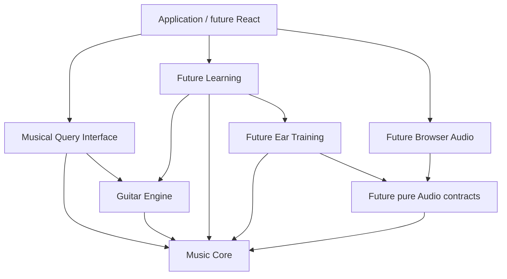

# Music Engine architecture

The user-approved engine architecture supersedes the v0.2 handoff's combined
`src/music` layout and UI-first kickoff. The current engine contains only Core,
Guitar and musical queries; later Audio, Ear and Learning modules remain documented
boundaries rather than placeholder code.

## Dependency direction

- **Core:** written notes, sounding pitches, intervals, formulas, collections and
  context. Pure and instrument-independent; no browser, storage or learner state.
- **Guitar:** tuning, physical string order and bounded geometry over Core.
  CAGED, 3NPS and other later views sit above this geometry.
- **Audio, future:** pure plans of resolved pitches and relative seconds, plus a
  separately imported browser adapter. No theory inference in the adapter.
- **Ear, future:** instrument-independent auditory generation/evaluation using
  Core and pure Audio contracts. It must never import Guitar.
- **Learning, future:** sessions, assistance, attempts and evidence. Hear → identify
  → find composes an Ear task with Guitar locations here, preserving the target
  across stages. Recognition, retrieval and transfer remain distinct evidence.
- **Musical Query Interface:** validated JSON-compatible facts from Core + Guitar.
  No playback commands, exercise sessions, mastery, history or persistence.

One TypeScript package is sufficient. Future React + Vite consumers will use public
engine exports rather than duplicate musical truth. There is no service split,
plugin system, dependency-injection container or theory DSL.

## Musical values and context

NoteName is letter plus integer accidental; Pitch adds scientific octave.
Sounding semitone numbers use C4=60 and are derived from spelling/register.
B#3 and C4 sound alike but retain distinct written identities.

Intervals retain signed letter and semitone displacement. Formula tones retain
actual degree and alteration relative to major/perfect intervals. Catalog requests
select a formula; resolved results include that formula and every derived tone.

Key, selected scale (with its own tonic), and current chord are independent.
Key-relative alteration and formula alteration are different measurements.
Sounding membership and exact spelling membership are reported separately.
See API.md for unison, spelling-precedence and numeric/resource conventions.

## Implemented key relationships — Phase 2A

Conventional signatures are located on a signed fifths axis from C major. Minor
keys reach that axis through their relative major. Alterations are generated in
conventional order from the fifths count; the engine does not store a table of
finished signatures for every key.

Relative keys and clockwise/counterclockwise fifths neighbors are constructed by
spelled interval transposition and retain the relationship interval in their
results. These relationships remain available outside the conventional signature
range, while signature and composed-profile requests beyond seven sharps/flats
return UNSUPPORTED. No key is inferred from unordered notes or a progression.

## Implemented scale breadth and context — Phase 2B

Scale formulas now include harmonic minor, ascending melodic minor, major/minor
pentatonic, minor blues and the remaining five major-scale modes. Formula identity
remains structured as `{ degree, alteration }`; minor blues deliberately declares
both flat-five and perfect-five references for written degree 5.

Selected-scale analysis is generalized independently from key analysis. A queried
written degree may have exactly one formula reference, no formula reference, or
multiple formula references. Scale relations therefore expose `referenceStatus`,
ordered `degreeReferences`, nullable `alterationFromScale`, and pitch-class-based
`matchingTones`. This preserves the distinction between written identity and
sounding membership without forcing pentatonic or blues collections into a
seven-degree assumption.

Key analysis remains major/natural-minor and seven-note by design. Broad harmonic
interpretation and functional analysis remain deferred.

## Implemented chord catalogue and Lab planning — Phase 2C

Core declares all 35 approved formulas in `CHORD_FORMULAS`. Catalogue metadata is
limited to identity and presentation fields, and catalogue construction attaches
the exact formula object rather than redeclaring theory. The public
`getChordCatalog({})` query returns frozen families and entries in deterministic
order through the existing version-1 envelope.

Chord formulas retain their abstract compound roles. A chordal 9, 11 or 13 keeps
its compound degree and canonical interval even when a chosen guitar location lies
within a simple octave of the root anchor. The Lab asks `getInterval` for the two
registered pitches and presents that played interval as a separate fact. This is
also the boundary between an abstract chord collection and a later concrete voicing.

The Lab planner is a pure consumer with injected randomness. It chooses permitted
material and a formula role, derives valid locations through Guitar queries, samples
an actual result, derives a containing window and freezes the complete plan.
Transfers preserve quality and exact degree/alteration identity on a different root.
Collections of at most four tones are reconstructed completely; longer formulas use
at most four structural roles while the complete formula remains visible and
authoritative. No inversion, fingering or voicing model is implied.

## Implemented diatonic harmony — Phase 2D

`buildDiatonicHarmony` is pure Core. An explicit major/minor key selects the major
or natural-minor scale; stacking its written degrees constructs seven triads or
sevenths. Matching those exact spellings and stack roles against the authoritative
chord formulas supplies canonical `Chord` identities. No per-key chord-answer table
or second formula authority is introduced.

`getDiatonicHarmony` returns the copied key, chord size and ordered degree entries
through the existing query envelope. Each entry contains a complete chord and a
frozen Roman identity derived from degree plus actual chord quality. This is
structural identity, without tonic/predominant/dominant classification, cadence,
resolution or progression claims. Minor requests never silently raise degree 7.

Practice Session v0 consumes this query and existing Guitar queries through one
frozen, curated G-major lesson plan. Three relevant retrieval prompts precede
Harmonic Gravity: physical context, perceived consequence, committed prediction,
contrasting outcomes, and one melodic response before theory compression. One
explanatory relationship, a two-note phrase, A-major transfer and reflection
complete the connected session. No full chord-construction drill is embedded.

The focused Harmony route and Practice Session serve the same page and app, using
the same lesson content. Harmony omits the retrieval warm-up. Physical locations
and explanatory notes derive from existing queries. The original Chord Lab remains
a separate tool. Curated home/pressure descriptions are lesson interpretations of
these chosen examples, not a new musical-truth function/cadence/progression API.
There is no generic Practice/Learning Engine, persistence, automatic scheduler or
performed-voicing evaluator. The guitar supplies the sound; the app cannot verify it.

### Lab-local voice-leading probe

`/voice-leading.html` is a second bounded learning probe, separate from Practice
Session v0. It consumes the existing diatonic-harmony, chord-catalogue, fretboard,
note-at-fret and interval queries. Its planner enumerates complete four-string chord
candidates in a small fret range and compares them with the learner's previously
accepted voicing by same-string fret distance. The tie-break order is deterministic:
total movement, largest single movement, then fret vector. All candidates tied at
the minimum total movement satisfy the learning constraint.

This calculation remains under `lab/`. It does not define a general voicing,
fingering, inversion, progression, harmonic-function or voice-leading model, and it
does not enter `musicQueries`. The experiment must first show that physically
following the separate voices improves learning. Its G-major example and A-major
transfer derive their musical identities and annotations from the engine; the Lab
owns only the bounded task, physical-distance rule, assistance sequence and local
session evidence.

### Fretboard UI v2 presentation boundary

The Lab shares `lab/fretboard-view.mjs` and `lab/fretboard.css` across Parsimonious
Path, Chord Lab, and the Practice Session retrieval warm-up. The renderer receives
an explicit view model: display-ordered strings, active strings, a fret range,
positions with selectable/selected states and short labels, and optional directed
connections. It draws six physical string lanes, frets, open positions, markers,
position controls and movement paths. Native buttons provide focus, selection and
keyboard navigation. A stationary connection receives a distinct ring rather than
a zero-length arrow. The focused Harmony route uses the Practice Session's shared
page but skips this warm-up, so its listening interactions are unchanged.

The consumer projects engine-derived musical facts and session decisions into
that view model. It decides which positions and labels exist before commitment,
which are revealed after checking or assistance, and what counts as correct. The
renderer does not infer pitches, chord roles, scale degrees, hints, candidate
voicings, movement efficiency or learner evidence. Parsimonious Path's bounded
enumeration and ranking remain in `lab/voice-leading-session.mjs`; Music Core and
`musicQueries` retain musical truth. The connection shape can display later
position relationships without encoding a chord or melody lesson now.

## Future rhythm/time domain — documentation only

A future instrument-independent time domain will describe meter, beats, duration,
subdivision and harmonic rhythm (when chords change). Musical positions/durations
remain distinct from Audio's scheduling seconds and Learning's wall-clock
timestamps/response times. A tempo-aware adapter will compile beat-based events
into audio plans. Chord identity itself will not acquire timing state.

Do not implement time types, a tempo map, transport or timing placeholders in the
current theory slices. Existing pitch/chord/context values can be referenced by
later timed events.

## Future Learning Query Interface — documentation only

Keep `musicQueries` the musical-truth surface. A separate future read-only Learning
Query Interface may expose attempts, assistance, retrieval/transfer evidence and
history through Learning and persistence. It may reference musical concept IDs or
compose musical facts at the application layer; learner state never enters Core
or musical query results.

## Later v1 direction and exclusions

Subsequently authorized slices may add harmony relationships, maps/triad
voicings, standard-tuning CAGED, playback and
all five auditory exercise families. The auditory-to-fretboard composition remains
owned by Learning. Evidence summaries precede mastery estimation.

Current Roman labels are key-relative structural identities: natural minor has
III, VI and VII. Future functional rules must distinguish these calculated facts
from interpretations, and must not infer a unique key automatically.

Western twelve-tone equal temperament is the foundation. Microphone/transcription,
DSP-heavy processing, AI authority, cloud sync, adaptive mastery, general chord-text
parsing, global voice-leading/fingering optimization and notation engraving remain
outside the current scope.
