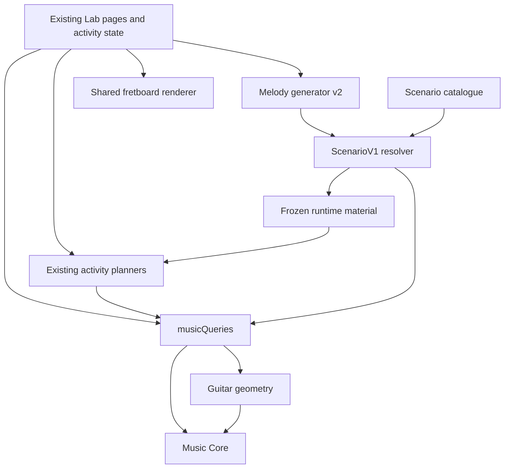
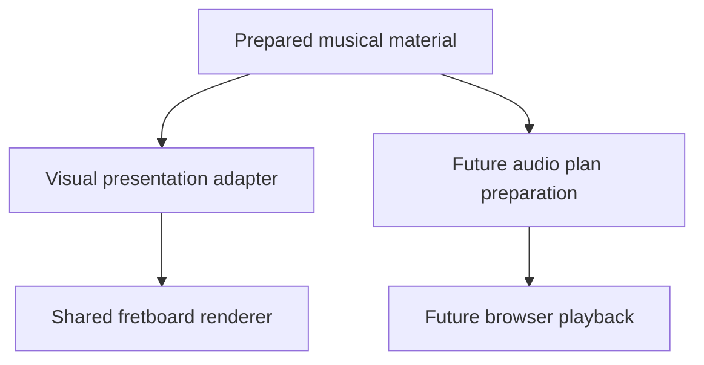

# Guitar Explorer architecture

This is the current source of truth for product architecture and engine boundaries.
It distinguishes implemented capabilities from the agreed Product Spine direction.
The Product Spine is documented, not implemented: there is no shared application
workspace, Experience Router or extracted Practice Policy module yet. This
consolidation authorizes no runtime restructuring or new musical capability.

The approved engine architecture supersedes the v0.2 handoff's combined `src/music`
layout and UI-first kickoff. `PRODUCT_SPEC.md` and `V0_2_PLAN.md` preserve historical
product requirements and implementation order; they do not authorize their old
Explore/Navigate/Harmony modes, telemetry, CAGED or React migration. `DECISIONS.md`
records the decision history, `LEARNING_MODEL.md` describes practice principles,
and `TEST_MATRIX.md` distinguishes current verification from historical targets.

## Product Spine — agreed direction, not yet implemented

Guitar Explorer is a **fretboard-first musical reasoning environment that helps
the guitarist see musical relationships they currently cannot see, hear those
relationships, physically locate them, manipulate them, and reuse them in real
music**. It is not primarily a course app.

One shared musical workspace has three primary user intentions:

| Intention | Organizing question | Responsibility |
|---|---|---|
| **Explore** | What relationships are here? | Broad, permissive inspection: reveal, compare and manipulate notes, chords, roles and regions. Open fretboard vision has no curriculum lock. |
| **Practice** | Can I retrieve and use this relationship independently? | Deliberate constraints, answer withholding, repetition, support, remediation and transfer. Practice Policy applies here. |
| **Apply** | What can I understand and do with this musical material? | Begin with selected material, such as a progression, chord or fragment; expose useful relationships, chord-tone connections and target-note paths. Later style knowledge and audio can support this work. |

These intentions belong to one application. A handoff should preserve the musical
question rather than restart an unrelated Lab. Apply describes an intention; it
does not mean arbitrary song/progression entry, import or generated licks already
exist. There is no arbitrary AI lick-generation direction.

The initial shared context should preserve selected material, explicit key,
selected scale and current chord where relevant, region, focus and active intent.
Key, selected scale and chord remain independent existing engine concepts. The
workspace need not contain every activity's internal state or a learner model.

### Experience Router — planned application responsibility

Use a small **Experience Router** to preserve selected musical context, understand
Explore/Practice/Apply intent, select compatible existing capabilities, prepare
material through the appropriate service, and preserve explicit handoff context.
Unsupported combinations and preparation/generation failures must be clear
outcomes. Practice launches apply the activity's Practice Policy.

The router must not own musical truth, chord/scale derivation, generator grammar,
activity state machines, style taste, learner mastery, fretboard geometry, playback
scheduling or subjective musical grading. Existing activity plans may retain their
own shapes; a universal workflow engine or generic stage schema is unnecessary.

### Practice Policy — planned boundary around explicit Practice

The previously discussed Pedagogical Governor becomes **Practice Policy inside
explicit Practice experiences**. It may specify the target relationship, variables
held constant, allowed variation, support, answer visibility, objective checks,
repetition, remediation and transfer. Existing sessions currently distribute these
decisions across their planners and page handlers; no policy framework is implied.

Explore and Apply remain accessible without XP, levels, unlock trees or mandatory
global prerequisite gates. Apply may offer a deliberate Practice handoff around
the selected relationship. Exploration need not adopt an assessment reveal sequence.

Universal musical validity, exercise compliance and musical judgment are separate.
A real chord can miss a minimum-movement constraint while remaining harmonically
correct. Assistance must remain visible in evidence; a screen selection does not
establish that a note was heard, sung or played correctly. Subjective musical
responses and reflections remain ungraded.

## Implemented system and dependency direction

| Capability | Current status |
|---|---|
| Music Core, Guitar and `musicQueries` | Implemented deterministic foundation through Phase 2D. |
| Chord, Practice/Harmony, Parsimonious Path, Melody and Motif Labs | Implemented browser consumers with separate page/session state and ephemeral evidence. |
| Fretboard UI v2 | Implemented shared rendering surface; consumers own theory adaptation and disclosure. |
| ScenarioV1, catalogue and resolver | Implemented bounded Melody/Motif material preparation. |
| Rule Generator V1 | Implemented Melody-only material source; current generator provenance is version 2. |
| Shared workspace, three-intention navigation, Experience Router, extracted Practice Policy | Agreed architecture only; not implemented. |
| Audio, Ear, learner model, persistent learning history, style knowledge | Future boundaries; no placeholder implementation. |

Arrows show consumption/preparation dependencies. The engine imports no consumer.
The simplified diagram omits the page-level adapters that unwrap query results.
Not every activity uses ScenarioV1.

- **Core:** written notes, sounding pitches, intervals, formulas, collections and
  context. Pure and instrument-independent; no browser, storage or learner state.
- **Guitar:** tuning, physical string order and bounded geometry over Core.
  CAGED, 3NPS and other later views sit above this geometry.
- **Musical Query Interface:** validated JSON-compatible facts from Core + Guitar.
  No playback commands, exercise sessions, mastery, history or persistence.
- **Lab services and activities:** bounded material preparation and teaching
  procedures consuming existing queries. These are not a production Learning Engine.
- **Presentation:** consumers supply prepared positions, labels, selection and
  connections to the shared fretboard; rendering derives no musical truth.

One TypeScript package and ordinary module boundaries remain sufficient. No backend,
service split, plugin system, dependency-injection container or theory DSL is needed.
UI framework migration is deferred; choosing React/Vite is not the next task.

## Material preparation and ScenarioV1

Material representation and teaching procedure remain separate. Ordinary Explore
inspection may use `musicQueries` directly; it does not require a scenario or
session. Apply may later use other material representations appropriate to the
selected music. ScenarioV1 is not Guitar Explorer's universal data model.

`ScenarioV1` remains a Lab-local contract for compatible Melody/Motif exercises:

- Spelled major keys for main and transfer contexts; three or four diatonic chord
  degrees, with triads or sevenths. Core's wider scale/key support does not expand it.
- Explicit main/transfer regions using string indices 0–5 and frets 0–15; declared
  chord-role targets and a later arrival must resolve within both chosen regions.
- Melody has an upward diatonic-step approach and two phrase-lead notes ascending
  into the target. Motif has rise-return cells plus an interval-preserving sequence.
- The resolver derives facts through queries and checks supported chord roles,
  exact spelled locations, registered motion and transfer invariance. Existence in
  a bounded region is not a general fingering or physical-playability assessment.
- Descriptive difficulty is not adaptation. No rhythm, articulation, style grammar,
  song analysis, aesthetic grading, learner state or playback is represented.

The plain scenario specification is serializable. Its resolved, frozen runtime
bundle includes query closures such as `at`, `tone` and `locate`; it is not a
persistable workspace document. A resolved scenario must also be compatible with
its activity: the current Melody interaction selects/evaluates on the target
string, so broader target/arrival string combinations represented by the schema
are not a promise of UI support. Preserve supported catalogue/generated choices.
See `SCENARIO_V1.md` for the detailed contract.

### Implemented Melody generation

Rule Generator V1 proposes ScenarioV1 Melody material, validates it through the
resolver, applies bounded material preferences and returns the accepted scenario,
resolved bundle and provenance to the existing Melody session. It generates no
Motif material and does not teach or evaluate a learner. Material scores do not
measure mastery or aesthetic quality.

The generator's supported region policy is narrower than ScenarioV1: target and
arrival use high E (index 5); the first phrase-lead note uses B (4) or high E (5).
Main/transfer windows derive independently from their target locations. Difficulty
changes approved key pools, not arbitrary strings or caller-selected regions.

Current provenance reports `generatorVersion: 2`; the Rule and Scenario contracts
remain V1. Fixed-order seeded Fisher–Yates selection and pinned fixtures protect
replay with the same rule, difficulty, seed, generator version and unchanged
engine/query facts and ordering. Version-1 seeded outputs are not preserved.
Distinct-generation exhaustion preserves accepted material and the active session,
shows a recoverable failure, and never falls back to unrestricted generation.
See `RULE_GENERATOR_V1.md` for the exact policy, budgets and replay contract.

## Musical values and context

NoteName is letter plus integer accidental; Pitch adds scientific octave.
Sounding semitone numbers use C4=60 and are derived from spelling/register.
B#3 and C4 sound alike but retain distinct written identities.

Intervals retain signed letter and semitone displacement. Formula tones retain
actual degree and alteration relative to major/perfect intervals. Catalog requests
select a formula; resolved results include that formula and every derived tone.

Key, selected scale (with its own tonic), and current chord are independent.
Key-relative alteration and formula alteration are different measurements.
Sounding membership and exact spelling membership are reported separately.
See API.md for unison, spelling-precedence and numeric/resource conventions.

## Implemented key relationships — Phase 2A

Conventional signatures are located on a signed fifths axis from C major. Minor
keys reach that axis through their relative major. Alterations are generated in
conventional order from the fifths count; the engine does not store a table of
finished signatures for every key.

Relative keys and clockwise/counterclockwise fifths neighbors are constructed by
spelled interval transposition and retain the relationship interval in their
results. These relationships remain available outside the conventional signature
range, while signature and composed-profile requests beyond seven sharps/flats
return UNSUPPORTED. No key is inferred from unordered notes or a progression.

## Implemented scale breadth and context — Phase 2B

Scale formulas now include harmonic minor, ascending melodic minor, major/minor
pentatonic, minor blues and the remaining five major-scale modes. Formula identity
remains structured as `{ degree, alteration }`; minor blues deliberately declares
both flat-five and perfect-five references for written degree 5.

Selected-scale analysis is generalized independently from key analysis. A queried
written degree may have exactly one formula reference, no formula reference, or
multiple formula references. Scale relations therefore expose `referenceStatus`,
ordered `degreeReferences`, nullable `alterationFromScale`, and pitch-class-based
`matchingTones`. This preserves the distinction between written identity and
sounding membership without forcing pentatonic or blues collections into a
seven-degree assumption.

Key analysis remains major/natural-minor and seven-note by design. Broad harmonic
interpretation and functional analysis remain deferred.

## Implemented chord catalogue and Lab planning — Phase 2C

Core declares all 35 approved formulas in `CHORD_FORMULAS`. Catalogue metadata is
limited to identity and presentation fields, and catalogue construction attaches
the exact formula object rather than redeclaring theory. The public
`getChordCatalog({})` query returns frozen families and entries in deterministic
order through the existing version-1 envelope.

Chord formulas retain their abstract compound roles. A chordal 9, 11 or 13 keeps
its compound degree and canonical interval even when a chosen guitar location lies
within a simple octave of the root anchor. The Lab asks `getInterval` for the two
registered pitches and presents that played interval as a separate fact. This is
also the boundary between an abstract chord collection and a later concrete voicing.

The Lab planner is a pure consumer with injected randomness. It chooses permitted
material and a formula role, derives valid locations through Guitar queries, samples
an actual result, derives a containing window and freezes the complete plan.
Transfers preserve quality and exact degree/alteration identity on a different root.
Collections of at most four tones are reconstructed completely; longer formulas use
at most four structural roles while the complete formula remains visible and
authoritative. No inversion, fingering or voicing model is implied.

## Implemented diatonic harmony — Phase 2D

`buildDiatonicHarmony` is pure Core. An explicit major/minor key selects the major
or natural-minor scale; stacking its written degrees constructs seven triads or
sevenths. Matching those exact spellings and stack roles against the authoritative
chord formulas supplies canonical `Chord` identities. No per-key chord-answer table
or second formula authority is introduced.

`getDiatonicHarmony` returns the copied key, chord size and ordered degree entries
through the existing query envelope. Each entry contains a complete chord and a
frozen Roman identity derived from degree plus actual chord quality. This is
structural identity, without tonic/predominant/dominant classification, cadence,
resolution or progression claims. Minor requests never silently raise degree 7.

Practice Session v0 consumes this query and existing Guitar queries through one
frozen, curated G-major lesson plan. Three relevant retrieval prompts precede
Harmonic Gravity: physical context, perceived consequence, committed prediction,
contrasting outcomes, and one melodic response before theory compression. One
explanatory relationship, a two-note phrase, A-major transfer and reflection
complete the connected session. No full chord-construction drill is embedded.

The focused Harmony route and Practice Session serve the same page and app, using
the same lesson content. Harmony omits the retrieval warm-up. Physical locations
and explanatory notes derive from existing queries. The original Chord Lab remains
a separate tool. Curated home/pressure descriptions are lesson interpretations of
these chosen examples, not a new musical-truth function/cadence/progression API.
There is no generic Practice/Learning Engine, persistence, automatic scheduler or
performed-voicing evaluator. The guitar supplies the sound; the app cannot verify it.

### Lab-local voice-leading probe

`/voice-leading.html` is a second bounded learning probe, separate from Practice
Session v0. It consumes the existing diatonic-harmony, chord-catalogue, fretboard,
note-at-fret and interval queries. Its planner enumerates complete four-string chord
candidates in a small fret range and compares them with the learner's previously
accepted voicing by same-string fret distance. The tie-break order is deterministic:
total movement, largest single movement, then fret vector. All candidates tied at
the minimum total movement satisfy the learning constraint.

This calculation remains under `lab/`. It does not define a general voicing,
fingering, inversion, progression, harmonic-function or voice-leading model, and it
does not enter `musicQueries`. The experiment must first show that physically
following the separate voices improves learning. Its G-major example and A-major
transfer derive their musical identities and annotations from the engine; the Lab
owns only the bounded task, physical-distance rule, assistance sequence and local
session evidence.

### Fretboard UI v2 presentation boundary

The Lab shares `lab/fretboard-view.mjs` and `lab/fretboard.css` across Parsimonious
Path, Chord Lab, the Practice Session retrieval warm-up, Melody Over Harmony and
Develop the Idea / Motif. The renderer receives
an explicit view model: display-ordered strings, active strings, a fret range,
positions with selectable/selected states and short labels, and optional directed
connections. It draws six physical string lanes, frets, open positions, markers,
position controls and movement paths. Native buttons provide focus, selection and
keyboard navigation. A stationary connection receives a distinct ring rather than
a zero-length arrow. The focused Harmony route uses the Practice Session's shared
page but skips this warm-up, so its listening interactions are unchanged.

The consumer projects engine-derived musical facts and session decisions into
that view model. It decides which positions and labels exist before commitment,
which are revealed after checking or assistance, and what counts as correct. The
renderer does not infer pitches, chord roles, scale degrees, hints, candidate
voicings, movement efficiency or learner evidence. Parsimonious Path's bounded
enumeration and ranking remain in `lab/voice-leading-session.mjs`; Music Core and
`musicQueries` retain musical truth. The same connection shape supports the
existing movement, melody and motif paths without owning their teaching procedure.

## Future audio, style and learning boundaries — documentation only

Visual fretboard presentation and audio presentation should be sibling consumers
of prepared musical material. Audio is a shared presentation/service capability,
not a final stage downstream of a fretboard lesson. A future adapter may compile
prepared pitches and timed events into pure playback plans; a separately imported
browser adapter schedules them without deriving theory or deciding disclosure.

This is a future boundary, not an implemented pipeline. Pure Audio contracts can
depend on Core; browser playback depends on those contracts. Future Ear tasks are
instrument-independent and depend on Core plus pure Audio contracts, never Guitar.
Future Learning composes Ear and Guitar for hear → identify → find, preserving the
target while distinguishing recognition, retrieval and transfer evidence.

Future **Style Packs are knowledge/preferences**, not product modes or automatic
standalone pages. They may influence target choices, phrase vocabulary,
articulation, rhythmic language, harmonic treatment and generated-idea preferences.
They cannot redefine engine facts or turn stylistic taste into objective validity.
ScenarioV1 does not represent most of this information; the existing rule boundary
does not promise style support without new contracts and later authorization.

## Future rhythm/time domain — documentation only

A future instrument-independent time domain will describe meter, beats, duration,
subdivision and harmonic rhythm (when chords change). Musical positions/durations
remain distinct from Audio's scheduling seconds and Learning's wall-clock
timestamps/response times. A tempo-aware adapter will compile beat-based events
into audio plans. Chord identity itself will not acquire timing state.

Do not implement time types, a tempo map, transport or timing placeholders in the
current theory slices. Existing pitch/chord/context values can be referenced by
later timed events.

## Future Learning Query Interface — documentation only

Keep `musicQueries` the musical-truth surface. A separate future read-only Learning
Query Interface may expose attempts, assistance, retrieval/transfer evidence and
history through Learning and persistence. It may reference musical concept IDs or
compose musical facts at the application layer; learner state never enters Core
or musical query results.

## Existing feature migration direction — not a runtime change

| Existing capability | Intended home and reuse |
|---|---|
| Chord Lab | Inspection portions move into Explore; retrieval, reconstruction and transfer become a Practice activity. Preserve both behaviors. |
| Practice Session / Harmonic Gravity | Practice, with the existing full-session and focused Harmony entry sharing one plan. |
| Parsimonious Path | Practice. Its bounded movement comparison may later support Explore/Apply after demonstrated reuse. |
| Melody Over Harmony | Practice. Contextual note analysis is reusable elsewhere. |
| Develop the Idea / Motif | Practice. Supported motif transformations may later support Apply. |
| Generated Melody Practice | A material source inside compatible Practice activities; no independent product destination. |
| Existing standalone Lab URLs | Retain during migration. Deprecate independent learner-facing destinations only after replacement is proven; keep useful regression/dev surfaces. |
| Preserved prototype and references | Historical and diagnostic evidence; no second production music engine. |

Share material services, context and the fretboard without forcing every activity
into one teaching sequence. Do not delete earlier useful work or rename existing
pages as if the three intentions were already implemented.

## Deferred until the Product Spine is proven

The following capabilities remain deferred and are not started by this architecture
decision. Each needs a concrete consuming flow and separate later authorization.

1. Style Pack V1.
2. Motif Generator.
3. Full audio layer.
4. Learner model.
5. Adaptive scheduling.
6. Arbitrary song/progression import.
7. Ultimate Guitar-style input.
8. External AI idea generation.
9. New standalone Labs.
10. ScenarioV2.
11. Broad voice-leading engine promotion.
12. UI framework migration.

The full audio layer's scope need not determine the scope of a later small audition
experiment, but no audio implementation is authorized now. Likewise, selecting
approved material for an eventual bounded Apply proof does not imply general
progression entry or song import.

Previously described harmony relationships, maps/triad voicings, standard-tuning
CAGED and auditory exercise families also remain unimplemented unless separately
authorized. Current Roman labels are key-relative structural identities: natural
minor has III, VI and VII. Future functional rules must distinguish calculated
facts from interpretations and must not infer a unique key automatically.

Western twelve-tone equal temperament remains the foundation. Microphone and
transcription, DSP-heavy processing, AI authority, cloud sync, general chord-text
parsing, global voice-leading/fingering optimization and notation engraving remain
outside current scope. Documentation of an extension point is not a request for
placeholder types, APIs or infrastructure.

## Architecture rules

1. **No automatic destinations.** A new capability must serve Explore, Practice,
   Apply or a shared service before gaining a learner-facing destination.
2. **One authority for musical facts.** The deterministic engine owns derivation;
   presentation, teaching, interpretation and style consume it.
3. **Preserve context across intentions.** Carry material, region and focus
   explicitly through supported Explore/Practice/Apply handoffs.
4. **Practice Policy applies only to explicit Practice.** Explore and Apply have no
   curriculum prerequisite gates.
5. **Separate material from teaching procedure.** Reusing musical material does not
   require a universal activity state machine.
6. **Keep ScenarioV1 bounded.** It serves compatible Melody/Motif exercises; direct
   queries and other later material representations remain valid alternatives.
7. **Separate validity, compliance and judgment.** A valid musical answer may miss
   an exercise constraint; musical taste is not objective correctness.
8. **Present prepared information.** Renderers and playback adapters do not infer
   theory, select pedagogy or decide assessment disclosure.
9. **Honor generation constraints and provenance.** Preserve explicit limits,
   version and replay information. Handle exhaustion without weakening guarantees.
10. **Describe observed evidence precisely.** Objective screen correctness,
    assistance, self-reported playing/hearing and future performed/audio evidence
    are distinct. Elapsed time alone is not mastery.
11. **Promote experiments after evidence.** Generalize an algorithm only after
    demonstrated reuse and physical value, with an explicitly reviewed contract.

## Interpreting learning research

The Musicianship System Design Plan informs experiments; it does not override
implemented musical contracts or grant implementation scope. Singing is useful
within practice, not an application-wide prerequisite. Exact latency thresholds
such as 800 ms require stronger evidence before becoming product rules; present
elapsed time includes thinking, guitar action and interface use.

Tonal stability is contextual interpretation knowledge rather than basic
pitch/interval truth. Minimum movement is an exercise constraint rather than a
universal measure of musical quality. Prose research examples never override
engine-verified facts. Claims that motif work is missing are historical: Develop
the Idea already exists, while a Motif Generator remains deferred.

## Next implementation boundary

The current work records decisions and reconciles documentation only. No
Experience Router implementation, shared-workspace state, UI redesign or new
feature begins here.

A separately authorized next runtime slice can extract one small DOM-free Melody
preparation seam joining catalogue/generated material to the existing Melody plan.
It should preserve the current activity, supported combinations, provenance,
failure recovery and answer withholding. It should not change engine contracts,
renderer geometry, teaching sequences, motif grammar or navigation, and should not
introduce a universal scenario schema. Broader workspace handoffs follow only after
that boundary is demonstrated and separately authorized.

Retain `npm run typecheck`, `npm test`, `npm run test:prototype` and
`npm run test:lab` as baseline checks. Add meaningful boundary coverage when runtime
changes are authorized. Current automated checks do not establish browser layout,
physical performance or pedagogical effectiveness; those need direct review.
