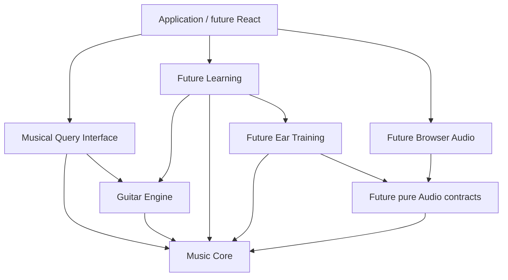

# Music Engine architecture

The user-approved engine architecture supersedes the v0.2 handoff's combined
`src/music` layout and UI-first kickoff. The current engine contains only Core,
Guitar and musical queries; later Audio, Ear and Learning modules remain documented
boundaries rather than placeholder code.

## Dependency direction

- **Core:** written notes, sounding pitches, intervals, formulas, collections and
  context. Pure and instrument-independent; no browser, storage or learner state.
- **Guitar:** tuning, physical string order and bounded geometry over Core.
  CAGED, 3NPS and other later views sit above this geometry.
- **Audio, future:** pure plans of resolved pitches and relative seconds, plus a
  separately imported browser adapter. No theory inference in the adapter.
- **Ear, future:** instrument-independent auditory generation/evaluation using
  Core and pure Audio contracts. It must never import Guitar.
- **Learning, future:** sessions, assistance, attempts and evidence. Hear → identify
  → find composes an Ear task with Guitar locations here, preserving the target
  across stages. Recognition, retrieval and transfer remain distinct evidence.
- **Musical Query Interface:** validated JSON-compatible facts from Core + Guitar.
  No playback commands, exercise sessions, mastery, history or persistence.

One TypeScript package is sufficient. Future React + Vite consumers will use public
engine exports rather than duplicate musical truth. There is no service split,
plugin system, dependency-injection container or theory DSL.

## Musical values and context

NoteName is letter plus integer accidental; Pitch adds scientific octave.
Sounding semitone numbers use C4=60 and are derived from spelling/register.
B#3 and C4 sound alike but retain distinct written identities.

Intervals retain signed letter and semitone displacement. Formula tones retain
actual degree and alteration relative to major/perfect intervals. Catalog requests
select a formula; resolved results include that formula and every derived tone.

Key, selected scale (with its own tonic), and current chord are independent.
Key-relative alteration and formula alteration are different measurements.
Sounding membership and exact spelling membership are reported separately.
See API.md for unison, spelling-precedence and numeric/resource conventions.

## Implemented key relationships — Phase 2A

Conventional signatures are located on a signed fifths axis from C major. Minor
keys reach that axis through their relative major. Alterations are generated in
conventional order from the fifths count; the engine does not store a table of
finished signatures for every key.

Relative keys and clockwise/counterclockwise fifths neighbors are constructed by
spelled interval transposition and retain the relationship interval in their
results. These relationships remain available outside the conventional signature
range, while signature and composed-profile requests beyond seven sharps/flats
return UNSUPPORTED. No key is inferred from unordered notes or a progression.

## Implemented scale breadth and context — Phase 2B

Scale formulas now include harmonic minor, ascending melodic minor, major/minor
pentatonic, minor blues and the remaining five major-scale modes. Formula identity
remains structured as `{ degree, alteration }`; minor blues deliberately declares
both flat-five and perfect-five references for written degree 5.

Selected-scale analysis is generalized independently from key analysis. A queried
written degree may have exactly one formula reference, no formula reference, or
multiple formula references. Scale relations therefore expose `referenceStatus`,
ordered `degreeReferences`, nullable `alterationFromScale`, and pitch-class-based
`matchingTones`. This preserves the distinction between written identity and
sounding membership without forcing pentatonic or blues collections into a
seven-degree assumption.

Key analysis remains major/natural-minor and seven-note by design. Broad harmonic
interpretation, Roman numerals and functional analysis are later Phase 2 work.

## Future rhythm/time domain — documentation only

A future instrument-independent time domain will describe meter, beats, duration,
subdivision and harmonic rhythm (when chords change). Musical positions/durations
remain distinct from Audio's scheduling seconds and Learning's wall-clock
timestamps/response times. A tempo-aware adapter will compile beat-based events
into audio plans. Chord identity itself will not acquire timing state.

Do not implement time types, a tempo map, transport or timing placeholders in the
current theory slices. Existing pitch/chord/context values can be referenced by
later timed events.

## Future Learning Query Interface — documentation only

Keep `musicQueries` the musical-truth surface. A separate future read-only Learning
Query Interface may expose attempts, assistance, retrieval/transfer evidence and
history through Learning and persistence. It may reference musical concept IDs or
compose musical facts at the application layer; learner state never enters Core
or musical query results.

## Later v1 direction and exclusions

Subsequently authorized slices add the approved broader chord catalog,
explicit-context harmony, maps/triad voicings, standard-tuning CAGED, playback and
all five auditory exercise families. The auditory-to-fretboard composition remains
owned by Learning. Evidence summaries precede mastery estimation.

Roman labels default to key-relative analysis in minor keys when an explicit key
context is supplied. They remain interpretations of explicit context rather than
inferred unique truth, and analytical rules must distinguish calculated facts from
interpretations.

Western twelve-tone equal temperament is the foundation. Microphone/transcription,
DSP-heavy processing, AI authority, cloud sync, adaptive mastery, general chord-text
parsing, global voice-leading/fingering optimization and notation engraving remain
outside the current scope.
