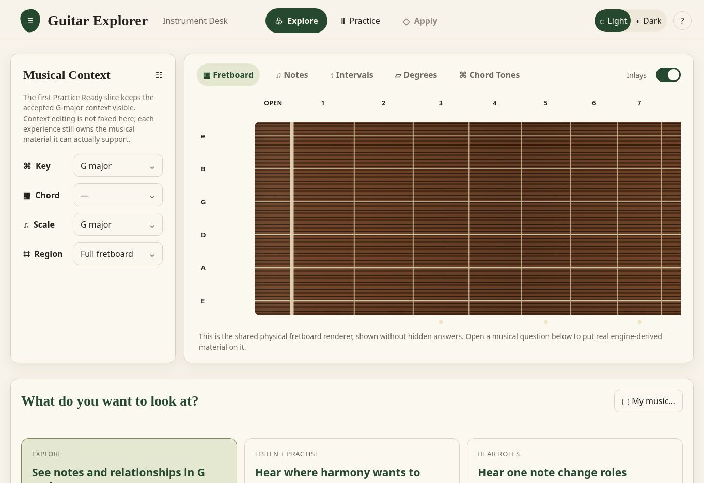
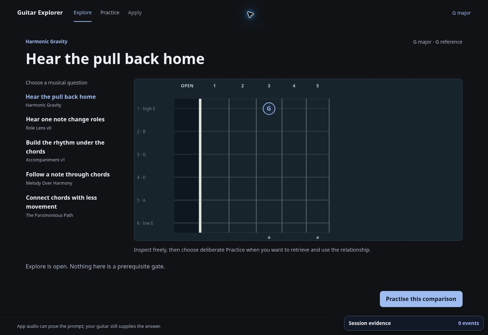
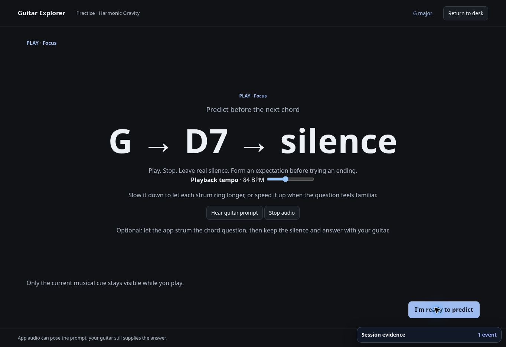
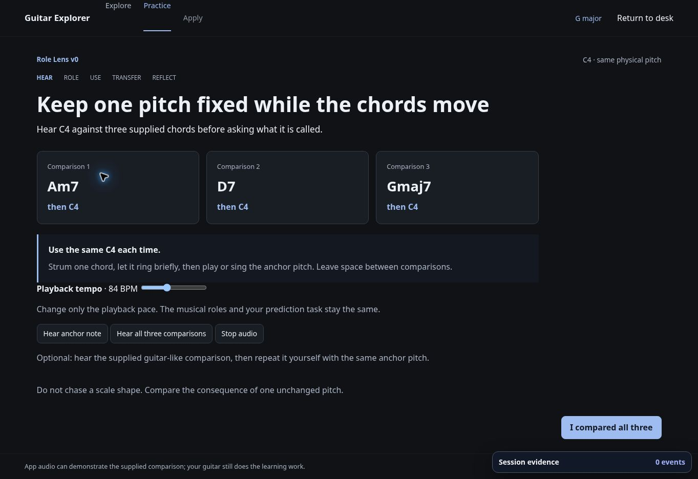
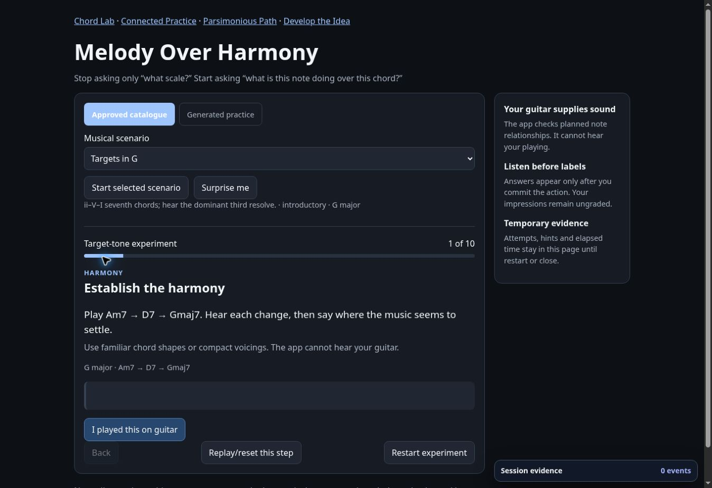
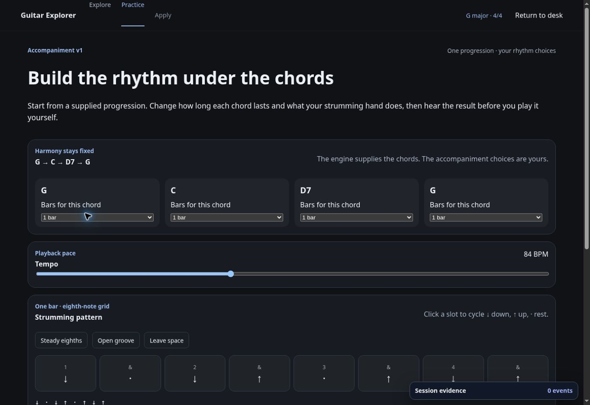

# Productization 1 blueprint

> Historical reference. The reset supersedes this plan and retires its runtime.
> See [project state](../PROJECT_STATE.md) for the active application.

Issue #70 is the primary milestone. First child: #71. Baseline: master b495276, inspected 3 November 2026. No claim of learner usefulness is inferred from this audit or automated checks.

## Current product-flow audit

Captured from a byte-checked local build of current master. The repository root Pages URL returned 404; stable publication is reserved, so it is not a supported product entry yet. The review surface remains the exact-head PR preview. This is an entry/handoff audit, not a claim that every legacy exercise was completed.

| Step | Health | Evidence and consequence |
| --- | --- | --- |
| 1. Open Home | Weak | Empty 0–12 fretboard dominates. Static context values have dropdown chevrons; Notes/Intervals/Degrees look like tabs but do nothing. Start is below the fold among six equally weighted experiment cards. |
| 2. Choose Practice | Weak | Opens Harmonic Gravity in Explore, then asks the learner to choose again. Brand links lead to this experiment rather than Home. No composed session or common completion state. |
| 3. Enter physical PLAY | Useful local behavior | Focused guitar action, prediction and silence are good. The flow is fixed material in its own shell; it is not a session entry/composer. Keep the physical-first principle. |
| 4. Open role comparison | Useful local behavior | One pitch over supplied harmony supports hearing/context. It resets into another five-step destination with its own shell; reuse its relationship/action rather than its navigation. |
| 5. Open Melody | Configuration first | Catalogue/generated source, scenario selector, start/surprise/restart and experiment labels compete with the actual guitar task. Existing generator/resolver is useful but Melody-local, not a universal contract. |
| 6. Open accompaniment | Tool presented as product | Four bar selectors, eight pattern slots and presets precede the physical use. Useful engine harmony, timing plan and strum scheduling should serve recipes with strong defaults. |

Screenshots in audit order:

Accessibility risks: tab/dropdown appearance without operability is misleading; primary actions sit below a large board; screen changes introduce inconsistent hierarchy/navigation. The blank heading in PLAY appears in the accessibility tree. These screenshots do not establish contrast compliance, screen-reader usability, touch ergonomics, timing, audio quality or physical-guitar success. Browser checks for the new child cover disclosure, keyboard interaction, theme and narrow layout; Arun supplies listening/physical evidence.

## Minimum information architecture

Home → Start or Continue Practice → one Practice Runtime → completion → another session or Home. Home has one clear default and only working focus choices. No catalogue, disabled Apply, My music placeholder, looper roadmap or developer evidence controls in the primary journey. Existing legacy URLs remain accessible for regression/reference; they are not promoted as product destinations.

The first child offers Fretboard + theory through major/minor thirds only. Ear, improvisation and rhythm become session filters when their recipes exist. Do not show fake breadth. Continue preserves the current session in this tab; reload starts fresh. There is no history, mastery label, account or progress database.

## Session and runtime state

Home → Find → Reveal/use → next round → Complete. Home may temporarily pause any active round; Continue restores its exact state. Stop audio on every view/task transition. A wrong screen choice permits retry; an explicit help reveal after an attempt is marked assisted. No microphone or inference about what the learner played.

The minimum session state contains version/seed/recipe, three prepared rounds, current round index, stage, selected position, attempt/help state, physical-use acknowledgement and ungraded reflection. Completion is workflow completion only. Do not count elapsed time as ability or claim a fixed practice duration was actually spent.

The milestone later composes three deliberately different families in this same shell:

| Family | Learner action | Hidden / reveal | Reusable tools |
| --- | --- | --- | --- |
| Interval Hunt | Locate, play, hear, use and move an interval | Target location/name until commitment; engine interval and chord-construction relation after | Shared fretboard; sampled plucks |
| Role Ear → Fretboard | Hear one pitch against changing chords; commit an impression; find/use it | Chord-role labels until listening response; subjective stability stays ungraded | Engine chord-role analysis; sampled comparisons; Role Lens concepts |
| Target Landing | Invent a short phrase and land on a supplied chord tone as harmony changes | Target choice/relationship according to task; no judging musical taste | Accepted accompaniment plan; curated placement; sampled backing; Melody target concepts |

## Thin responsibilities

1. Material Generator: finite, deterministic candidates from existing pitch/location/interval/chord queries; explicit region, renderer coverage and exhaustion. No new theory arithmetic or hidden tonic inference. Material knows musical facts, not DOM or session stage.
2. Exercise Recipe: a small local object/function for question, physical action, disclosure, allowed variation and transfer invariant. Current contract needs only family, interval quality, prepared rounds and prompts. Do not invent a general executable JSON language.
3. Session Composer: choose an initial interval, same relationship in another register, then the same interval from another root. Preserve the engine interval, change the physical route. Version + seed make it repeatable. No adaptation, mastery or scheduling.
4. Practice Runtime: one header/progress/task area, prepared fretboard model, audio controls, response/reveal/use controls and completion. It owns disclosure and view transitions; fretboard/audio render already prepared data. Family-specific actions can differ without separate pages.

## First child and audio path

#71 proves one complete short session, not the full 10–15 minute mixed-family milestone. It uses only major/minor thirds, standard tuning and frets 0–3, with a bounded set of recorded positions. The generator verifies pitch and interval through the Music Engine and explicitly rejects insufficient audio coverage. It does not broaden generation silently.

Extract from closed #58 only the small native-Web-Audio sample scheduler and recorded attacks actually used. Keep exact source hashes, byte counts and CC0 license. No A/B checkbox or reopened/stacked PR. Renderer selects per-string attacks and schedules prepared events; it does not choose harmony. Errors are visible/retryable, and the physical task remains possible without audio. Do not silently substitute the oscillator.

#56's G/C/D7 curated voicings are not needed for this interval child. Extract them only when a later role/backing recipe requires chord audition; validate them against engine chord tones. No general voicing solver, sampler/SFZ/SoundFont layer or tone system.

## Retain, remove, defer

| Code / surface | Decision |
| --- | --- |
| Music Core, Guitar geometry, musicQueries | Retain unchanged as truth. |
| Shared fretboard and keyboard navigation | Reuse with prepared hidden/revealed position models. |
| Approved warm light/dark tokens | Reuse; change flow, not visual direction. |
| Home catalogue, pretend context editors, placeholder My music/Apply | Remove from primary learner UI in #71. |
| Legacy Harmonic Gravity/Role/Melody/voice-leading routes | Retain for accepted contracts/reference; migrate useful actions incrementally. No bulk router rewrite. |
| Melody generator / ScenarioV1 | Keep local. Reuse proven bounded-generation ideas, not force all material through it. |
| Accompaniment plan / Web Audio clock | Retain. Later embed progression, tempo, simple groove, play/stop in a recipe; bar editor becomes secondary. |
| Synth | Keep legacy/developer infrastructure; absent from new normal Practice audio. |
| Session Evidence tooling | Keep validation infrastructure; no automatic overlay or data collection in new Home/runtime. |
| Looper, style, songs, tone, AI, grading, backend and learner models | Deferred by #70. No roadmap controls. |

## Review gates and next decision

Full npm run verify, exact-head PR preview, browser checks, then Arun's acoustic-guitar/listening review and explicit approval. Review whether the short loop actually changes hearing/search/physical use and whether the register/root variation transfers. Only after that evidence should the next child add Role Ear → Fretboard inside this runtime; Target Landing follows with simple backing. Do not mark #70 complete from #71.
